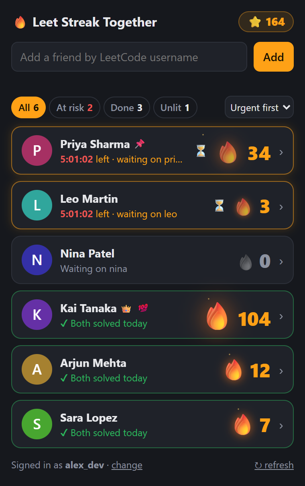
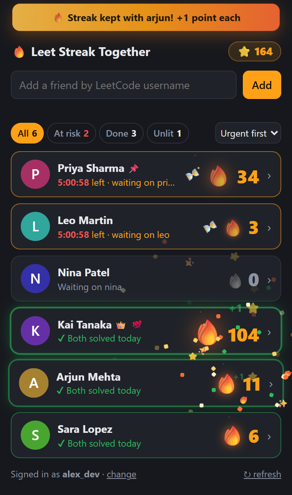
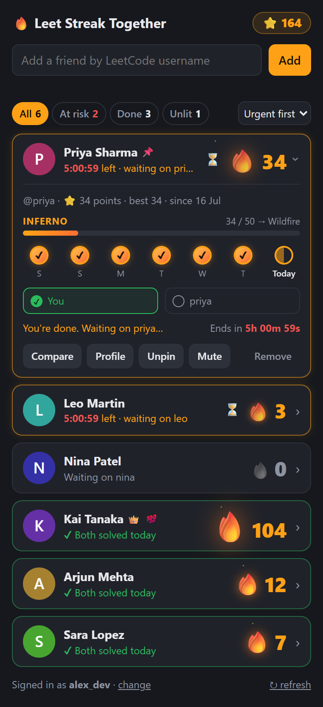
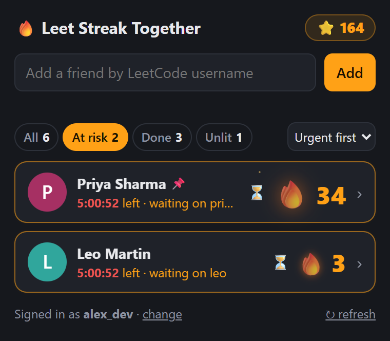
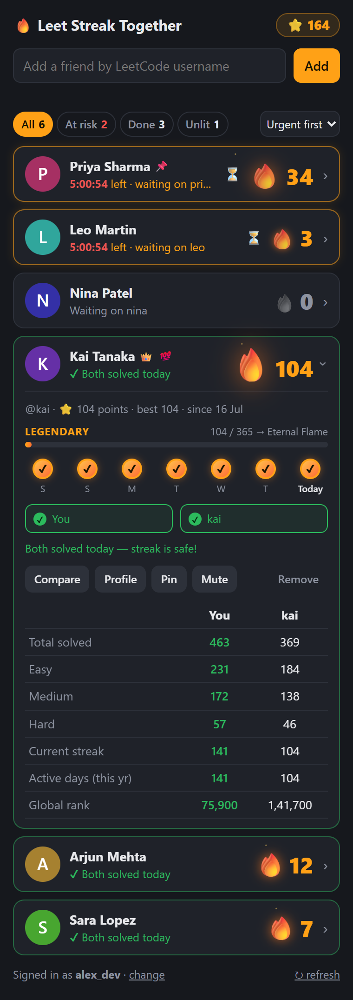
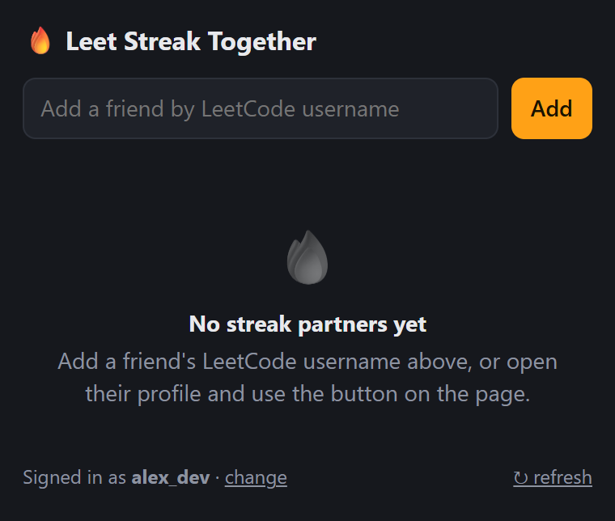

# 🔥 Leet Streak Together

Keep your LeetCode streak alive **with friends**. A browser extension for Firefox and Chrome that tracks a shared daily streak with each friend, Snapchat-style: you both solve a problem today, the flame grows. One of you skips, it goes out.

<p align="center">
  
  
  
</p>

## Features

- **A streak per friend** – add up to 30 friends by LeetCode username, or from the button the extension adds to any `leetcode.com/u/<name>` profile page.
- **Snapchat-style list** – one row per friend with the 🔥 count, a ⏳ hourglass and live countdown when a streak is about to expire, 👑 on your longest live streak and 💯 at 100+ days.
- **Game feel** – the flame grows through nine levels (Spark → Kindling → On Fire → Blazing → Inferno → Wildfire → Legendary → Eternal Flame), with an XP bar to the next level, a 7-day tracker, and confetti the first time you open the popup after you've both solved.
- **Manage many streaks** – filter by *At risk / Done / Unlit*, sort by urgency, length, points, name or newest, **pin** favourites to the top, **mute** reminders for a single streak.
- **Reminders** – a notification in the evening (or 3 hours before the reset) when a streak is at risk; several at-risk streaks are combined into one notification. The toolbar badge shows your longest live streak, green when today is done and red when it isn't.
- **Compare** – side-by-side solved counts, solo streak, active days and global rank.
- **Private by design** – no account, no server, no analytics. It only talks to `leetcode.com`.

<p align="center">
  
  
  
</p>

## How streaks work

- A day counts when **both** of you have activity on LeetCode's calendar for that day. Each such day is worth one point each.
- Days follow LeetCode's calendar, which is **UTC**. The countdown in the popup shows the time left until the UTC reset.
- A streak starts on the day you add a friend; earlier days don't count.
- The streak survives until the end of the current day even if only one of you has solved so far, and resets if a full day is missed.
- LeetCode's public calendar counts any submission on a day, not only accepted ones, so that is what the extension can see.

## Install

### Firefox

Available On Add-On Store: https://addons.mozilla.org/en-US/firefox/addon/leet-streak-together/

Temporary install for trying it out:

1. Open `about:debugging#/runtime/this-firefox`
2. Click **Load Temporary Add-on…** and pick `manifest.json`

Or run it in a clean profile with auto-reload: `npm run firefox`.

### Chrome / Edge

1. Open `chrome://extensions` (or `edge://extensions`) and turn on **Developer mode**
2. Click **Load unpacked** and pick this folder

Then click the toolbar icon, enter your LeetCode username (or use *Detect from my logged-in session*), and add a friend.

## Permissions

| Permission | Why |
| --- | --- |
| `https://leetcode.com/*` | Read public profiles and solve calendars; add the button on profile pages |
| `storage` | Save your username, friends, pins and mutes (synced with your browser account) |
| `alarms` | Hourly background refresh |
| `notifications` | At-risk reminders |

Profile requests are sent without cookies. The only request that uses your LeetCode session is the optional *Detect* button, which asks LeetCode who is signed in.

## Development

The extension is plain HTML, CSS and JavaScript modules: no build step and no dependencies. Node 20+ is only needed for the tooling below.

```
npm test             # unit tests for the streak logic (lib.js)
npm run test:live    # the same code against the real LeetCode API
npm run preview      # popup in a normal tab with fake data: http://localhost:5599/?s=demo&reset
npm run lint         # Mozilla's add-on linter
npm run build        # dist/leet_streak_together-<version>.zip for addons.mozilla.org
```

The preview server (`tests/preview-server.mjs`) fakes the `chrome.*` APIs and LeetCode, with scenarios such as `?s=demo`, `?s=many`, `?s=setup`, `?s=empty`, plus `&offline`, `&fail=<user>` and `&perm=0` for error states. Add `&reset` to start from a clean state. The screenshots above are generated from it with `node tests/screenshots.mjs <path to Edge or Chrome>`; the people in them are made up.

| File | What it does |
| --- | --- |
| `lib.js` | LeetCode API, streak maths, levels, storage |
| `popup.html` / `popup.js` / `popup.css` | The popup UI and animations |
| `background.js` | Hourly refresh, reminders, badge |
| `content.js` / `content.css` | "Streak together" button on profile pages |

## License

[MIT](LICENSE) © Lakshya Agrawal

---

Not affiliated with LeetCode.
